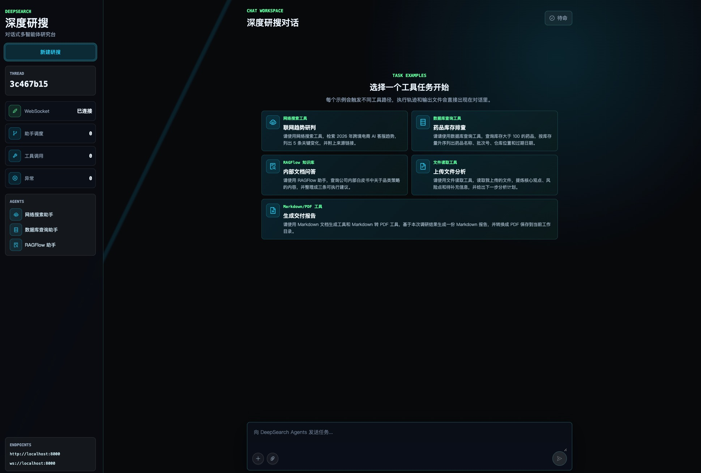
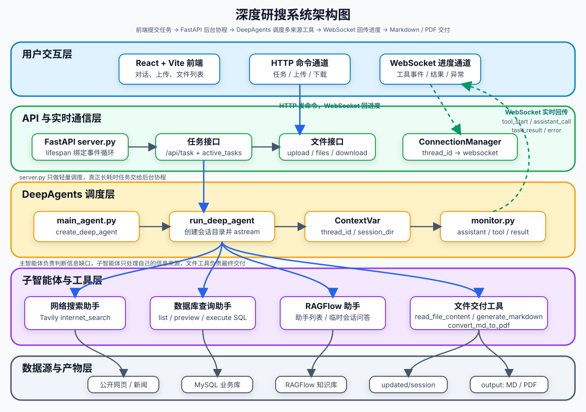
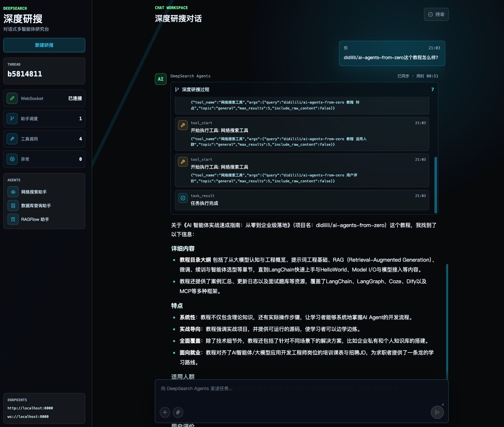

<div align='center'>
  <h1 style="margin-top: 15px;">「深度研搜」对话式多智能体研究系统</h1>
  <h4><b>deepsearch-agent</b></h4>
  <p><em>基于 DeepAgents 构建的企业级多智能体深度研究平台：主智能体统一调度，专家助手分工检索，多源证据汇总，成果直接落盘交付</em></p>
</div>

<div align='center'>


[快速开始](#quick-start) • [核心能力](#features) • [系统架构](#architecture) • [技术实现](#implementation) • [接口契约](#api)

</div>



## 📖 项目定位

大模型单轮问答解决不了真实研究任务。一个「整理机器人行业研究报告并生成 PDF」的指令，背后需要判断信息源、抓取公开资料、查询业务数据库、检索私有文档、读取用户附件，最后把多源证据汇总成交付物。

「深度研搜」把这条链路完整工程化：用户只提出任务，系统在后端组织一条**可观察、可中断、可追溯**的多智能体执行链路，并把过程与结果实时推送到前端。

```text
用户任务
  -> FastAPI 接收请求
  -> run_deep_agent 创建会话目录并写入上下文
  -> 主智能体分析任务并规划步骤
  -> 分派给 网络搜索 / 数据库查询 / 知识库 专家助手
  -> 主智能体汇总多来源证据
  -> 调用文件工具生成 Markdown / PDF
  -> monitor 通过 WebSocket 推送执行进度
  -> 前端展示事件流、答案与产物文件
```

<a id="features"></a>

## ✨ 核心能力

- **一主三从的多智能体编排**
  - 主智能体负责任务拆解、专家调度与结果汇总；三个专家助手各自负责一类信息源，上下文彼此隔离。
- **多来源检索而非模型裸答**
  - `Tavily` 负责公开网络资料，`MySQL` 负责结构化业务数据，本地向量知识库负责私有文档，上传附件由主智能体直接读取。
- **可核对的知识库检索**
  - 返回带分类、文件名、页码与相关度分数的原文片段；提示词层强制约束引用口径，禁止把范围值改写为单点值、禁止用常识补齐原文未说明的条件。
- **从检索到交付的完整闭环**
  - 不停留在 Prompt 设计，真实调用工具、读取数据、生成 Markdown，并按需转换为 PDF 落盘。
- **长任务执行过程全程可观察**
  - 工具调用、子智能体调用、工作目录创建、任务结果、取消与异常均通过 `monitor` 推送到前端，形成可回放的事件流。
- **会话级上下文隔离**
  - 通过 `thread_id` 与 `session_dir` 区分任务，`ContextVar` 让深层工具也能拿到当前会话身份和文件目录，避免并发任务互相污染。
- **清晰的工程分层**
  - `DeepAgents + FastAPI + WebSocket + React` 四层解耦，智能体层、工具层、服务层、文件层职责分明。

<a id="architecture"></a>

## 🏗️ 系统架构



采用 DeepAgents 典型的 **Orchestrator-Workers** 模式：主智能体是调度中心，三个专家助手负责信息获取，文件工具由主智能体直接掌握。

项目围绕两条主线展开：

| 主线 | 做什么 | 涉及模块 |
| --- | --- | --- |
| 多智能体深度研搜 | 规划、分派、检索、读取附件、汇总与生成交付物 | `DeepAgents` / `LangChain` / `LangGraph` / `Tavily` / `MySQL` / 本地向量库 |
| 前后端实时闭环 | 启动任务、上传文件、推送过程、展示结果与下载产物 | `FastAPI` / `WebSocket` / `React` / `Vite` |

### 智能体与工具

| 归属 | 能力 | 工具 |
| --- | --- | --- |
| 主智能体 | 任务规划、助手调度、结果汇总、文件交付 | `read_file_content`、`generate_markdown`、`convert_md_to_pdf` |
| 网络搜索助手 | 查询互联网公开信息、新闻、政策与网页资料 | `internet_search` |
| 数据库查询助手 | 发现表名、预览表结构与样例数据、执行 SQL | `list_sql_tables`、`get_table_data`、`execute_sql_query` |
| 知识库助手 | 发现可用分类、检索私有文档原文片段 | `list_knowledge_bases`、`ask_knowledge_base` |



<a id="implementation"></a>

## 🛠️ 技术实现

| 模块 | 技术 | 作用 |
| --- | --- | --- |
| 智能体框架 | `DeepAgents` | 创建主智能体与子智能体，承接长任务、多工具、多助手调度 |
| 图与检查点 | `LangGraph` | 提供底层运行时与 `InMemorySaver` 会话检查点 |
| 模型与工具抽象 | `LangChain` / `langchain-core` | 封装 OpenAI 兼容模型、工具声明与 Agent 调用结构 |
| 大模型接入 | OpenAI 兼容接口 | 通过 `.env` 中的 `OPENAI_BASE_URL`、`OPENAI_API_KEY`、`LLM_QWEN_MAX` 接入模型 |
| 网络搜索 | `Tavily` | 为网络搜索助手提供公开资料检索 |
| 结构化数据 | `MySQL` / `mysql-connector-python` | 为数据库助手提供制药业务数据（药品、库存、销售） |
| 私有知识库 | 本地轻量 RAG（`numpy` + Embedding API） | 为知识库助手提供内部文档向量检索 |
| 文件处理 | `pypdf` / `python-docx` / `pandas` / `ReportLab` | 读取上传附件、生成 Markdown、转换 PDF |
| 后端接口 | `FastAPI` / `Uvicorn` | 提供任务、取消、上传、文件列表、下载与 WebSocket 接口 |
| 实时通信 | `WebSocket` | 推送工具调用、助手调用、最终结果与错误事件 |
| 前端 | `React` / `Vite` / `Ant Design` / `Tailwind CSS` | 对话式研搜界面、事件流、附件上传与文件下载 |
| 依赖管理 | `uv` / `pnpm` | 管理 Python 后端与前端依赖 |
| 工程质量 | `pytest` / `ruff` / GitHub Actions | 单测、静态检查、安全评测门禁与镜像构建 |
| 可观测性 | `loguru` | 结构化日志，自动注入 session / thread 上下文 |
| 容器化 | Docker 多阶段构建 | 非 root 运行、双探针健康检查 |

### 知识库检索方案

项目实现了两套可切换的知识库接入：默认的**本地轻量 RAG** 与可选的 **RAGFlow**。

本地轻量 RAG 的设计取舍：

- **文档解析**：`pypdf` / `python-docx` / `openpyxl`，支持 PDF、Word、Excel、Markdown、TXT
- **切块策略**：500 字/块、重叠 80 字，兼顾语义完整度与召回粒度
- **向量化**：OpenAI 兼容 Embedding 接口，默认 `BAAI/bge-m3`（1024 维）
- **检索**：`numpy` 余弦相似度，索引以 `.npy` + `.json` 落盘，指纹校验自动感知文档变更
- **实测表现**：5 份研报共 468 个片段，建索引约 20 秒，检索命中相关度 0.64–0.80，无关底噪 0.35–0.45

RAGFlow 版本的工具实现以注释形式完整保留在 `app/tools/ragflow_tools.py`、`app/agent/subagents/knowledge_base_agent.py`、`app/prompt/prompts.yml` 中，部署 RAGFlow 后恢复对应注释即可切回。

## 📁 项目结构

```text
deepsearch-agent/
├── app/
│   ├── agent/
│   │   ├── subagents/              # 网络搜索、数据库查询、知识库三个子智能体
│   │   ├── llm.py                  # OpenAI 兼容模型初始化
│   │   ├── main_agent.py           # 主智能体组装与 run_deep_agent 执行入口
│   │   └── prompts.py              # 读取 app/prompt/prompts.yml
│   ├── api/
│   │   ├── context.py              # ContextVar 保存 thread_id 与 session_dir
│   │   ├── monitor.py              # 工具调用、助手调用、结果与异常事件推送
│   │   └── server.py               # FastAPI 任务、上传、文件、下载、健康检查、WebSocket 接口
│   ├── infra/                      # 基础设施层：SQL 安全护栏、结构化日志
│   ├── knowledge/
│   │   └── local_kb.py             # 本地轻量 RAG 引擎（解析、切块、向量化、检索）
│   ├── prompt/
│   │   └── prompts.yml             # 主智能体与子智能体提示词配置
│   ├── ragflow/                    # RAGFlow 配置加载与知识库初始化脚本（可选方案）
│   ├── tools/                      # Tavily、MySQL、知识库、文件读取、Markdown、PDF 工具
│   ├── utils/                      # 路径解析（含越界拦截）、Markdown/PDF 底层转换
│   ├── output/                     # 运行时生成：每个会话的 Markdown、PDF 产物
│   └── updated/                    # 运行时生成：用户上传文件的会话暂存目录
├── .github/workflows/ci.yaml       # CI：Lint、单测、安全评测门禁、镜像构建
├── docker/
│   ├── docker-compose.yaml         # 本地 MySQL 业务数据库
│   └── mysql/mysql.sql             # 药品、库存、销售业务模拟数据
├── docs/
│   ├── images/                     # 架构图与界面截图
│   └── knowledge_base/             # 知识库示例资料（金融、电商两类）
├── eval/
│   ├── golden_set.yaml             # 安全护栏回归评测集
│   └── run_eval.py                 # 离线评测执行入口
├── frontend/                       # React + Vite 前端项目
├── tests/                          # pytest 单元测试（护栏、路径解析、上传接口）
├── .env.example                    # 环境变量示例
├── Dockerfile                      # 后端两阶段构建镜像
├── pyproject.toml                  # Python 项目依赖与 ruff / pytest 配置
├── requirements.txt                # 依赖清单
└── uv.lock                         # uv 锁定文件
```

<a id="quick-start"></a>

## 🚀 快速开始

### 1. 准备环境

- Python `3.12`
- `uv`
- Docker 与 Docker Compose
- Node.js 与 `pnpm`
- 可用的大模型 API Key（OpenAI 兼容）
- Tavily API Key

### 2. 安装依赖

```bash
git clone https://github.com/qi-bao258/deepsearch-agent.git
cd deepsearch-agent
uv sync
```

### 3. 配置环境变量

```bash
cp .env.example .env
```

按本机实际服务与密钥修改 `.env`：

```bash
# LLM 配置
OPENAI_BASE_URL=https://api.siliconflow.cn/v1
OPENAI_API_KEY=你的大模型_API_KEY
LLM_QWEN_MAX=deepseek-ai/DeepSeek-V3

# Tavily 配置
TAVILY_API_KEY=你的_TAVILY_API_KEY

# Embedding 配置（本地知识库使用）
EMBEDDING_BASE_URL=https://api.siliconflow.cn/v1
EMBEDDING_API_KEY=你的_EMBEDDING_KEY
EMBEDDING_MODEL=BAAI/bge-m3
EMBEDDING_BATCH_SIZE=16
KB_TOP_K=5

# MySQL 配置
MYSQL_USER=root
MYSQL_PASSWORD=root
MYSQL_DATABASE=deepsearch_db
MYSQL_HOST=localhost
MYSQL_PORT=3307
MYSQL_CHARSET=utf8mb4
MYSQL_COLLATION=utf8mb4_unicode_ci
MYSQL_SQL_MODE=TRADITIONAL
```

### 4. 启动 MySQL 业务库

`docker/mysql/mysql.sql` 会在 MySQL 容器首次创建数据目录时自动导入药品、库存与销售记录。

```bash
docker compose -f docker/docker-compose.yaml up -d
```

### 5. 准备知识库

把资料放入 `docs/knowledge_base/<分类名>/` 即可，仓库已自带金融、电商两类示例资料。索引在首次任务触发时自动构建。

手动构建与检索自测：

```bash
.venv\Scripts\python.exe -m app.tools.local_kb_tools
```

### 6. 启动后端

```bash
uv run uvicorn app.api.server:app --host 0.0.0.0 --port 8000 --reload
```

### 7. 启动前端

```bash
cd frontend
pnpm install
pnpm dev
```

默认连接 `http://localhost:8000` 与 `ws://localhost:8000`，可在 `frontend/.env.local` 中通过 `VITE_API_BASE_URL`、`VITE_WS_BASE_URL` 覆盖。

## 🛡️ 安全边界

模型生成的 SQL、文件路径和上传文件名都不可信——提示词注入可以让它返回 `DROP TABLE`、`../../.env` 或 `../../app/config.py`。本项目没有把这些风险交给提示词，而是在工具层做了程序化拦截：

| 风险面 | 拦截位置 | 机制 |
| --- | --- | --- |
| SQL 写操作与注入 | `app/infra/sql_guard.py` | 语句白名单（仅 `SELECT` / `WITH`）、禁止关键字词边界扫描、多语句拦截、强制 `LIMIT` |
| 表名 / 字段名注入 | `app/infra/sql_guard.py` | 标识符仅允许 `[A-Za-z_][A-Za-z0-9_]{0,63}` |
| 文件路径越界 | `app/utils/path_utils.py` | `resolve()` 后校验，仅放行会话目录与 `updated/`，其余抛 `PathSecurityError` |
| 上传文件名穿越 | `app/api/server.py` | 剥离目录成分、落盘路径二次确认、拒绝含 `..` 的 `thread_id`、50 MB 单文件上限 |

设计上有两个细节值得说明：

- **词边界匹配**：`update_time` 不会被误判为 `update` 关键字；`WHERE name = 'delete'` 里的字面量也不会触发拦截。
- **LIMIT 强制补齐**：无 `LIMIT` 时自动补、超界时自动收紧，避免一次查询把整张表拉回模型上下文。

## ✅ 测试与评测

```bash
uv run pytest -q                    # 54 个用例：SQL 护栏、标识符、路径解析、上传接口
uv run python -m eval.run_eval      # 安全护栏回归评测，输出通过率与 JSON 报告
uv run ruff check .                 # 静态检查
uv run ruff format --check .         # 格式检查
```

`eval/golden_set.yaml` 收录 32 条用例，覆盖三类边界：语句类型与时序（`s001–s014`）、标识符长度与字符集（`i001–i010`）、路径放行与越界（`p001–p008`）。

评测门槛设为 **100%**，与检索质量的模糊阈值不同：护栏是确定性规则，任何一条既有判定被改变都属于回归。因此它适合作为 CI 门禁——`.github/workflows/ci.yaml` 中评测与单测是两个独立 job，单测失败说明代码坏了，评测失败说明安全判定被改了，两类问题分开定位。

## 🐳 容器化

```bash
docker build -t deepsearch-agent .
docker run --rm -p 8000:8000 --env-file .env deepsearch-agent
```

国内网络下 PyPI 直连可能极慢，可指定镜像源：

```bash
docker build --build-arg UV_INDEX_URL=https://mirrors.aliyun.com/pypi/simple/ -t deepsearch-agent .
```

镜像采用两阶段构建（`builder` 装依赖 → `runtime` 只拷虚拟环境），运行阶段不含包管理器；以非 root 用户 `appuser` 运行；`HEALTHCHECK` 打 `/health/ready`，配置漏填时会被标记为不健康，而非等用户请求失败才发现。

两个探针的职责分开：`/health` 只判进程存活，`/health/ready` 校验关键环境变量是否齐备，避免把外部服务抖动误判成本服务不可用而触发反复重启。

<a id="api"></a>

## 🔌 接口契约

| 接口 | 说明 |
| --- | --- |
| `POST /api/task` | 启动一次 DeepAgents 后台任务 |
| `POST /api/task/{thread_id}/cancel` | 取消指定会话任务 |
| `POST /api/upload` | 上传一个或多个文件到当前会话 |
| `GET /api/files` | 列出当前会话输出目录中的生成文件 |
| `GET /api/download` | 下载输出目录中的文件 |
| `GET /health` | 存活探针 |
| `GET /health/ready` | 就绪探针，校验关键环境变量 |
| `WebSocket /ws/{thread_id}` | 推送工具调用、助手调用、结果与异常事件 |

事件类型：`session_created`、`assistant_call`、`tool_start`、`task_result`、`error`。

## 🚧 能力边界

「深度研搜」聚焦多智能体工程主链路，覆盖 DeepAgents 调度、真实工具接入、文件交付、FastAPI 接口、WebSocket 实时推送、安全护栏、单元测试与容器化。以下生产治理能力未刻意展开：

- 用户登录、角色权限与多租户隔离
- 文件上传的病毒扫描与内容审核
- 任务队列、分布式执行与大规模并发治理
- 全量事件持久化、历史会话恢复与审计追踪
- 生产监控、告警、链路追踪与灰度发布
- 复杂报告编辑、协同工作流与权限化文件管理

这些能力适合在主链路跑通之后继续扩展。当前版本的目标是把多智能体研究系统最关键的工程骨架做扎实、跑稳定。
